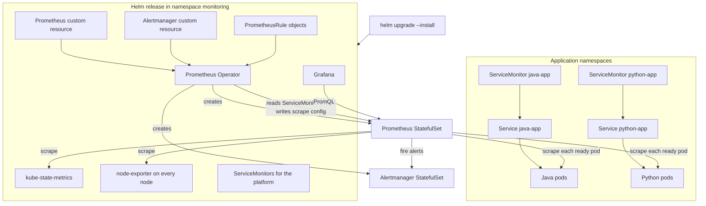
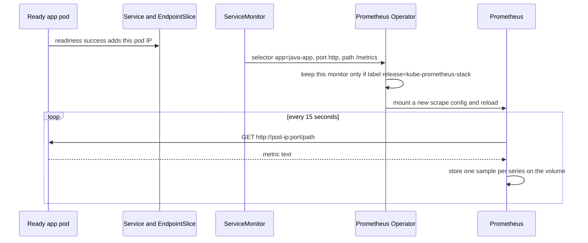
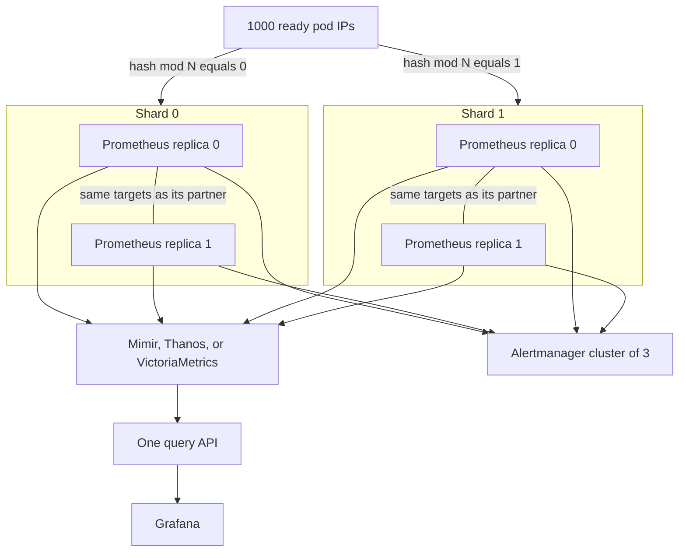
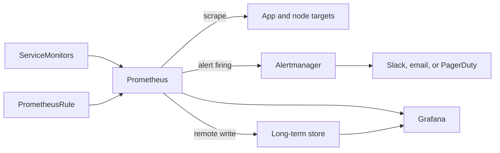

# Production Prometheus with Helm

The lab installs one Prometheus by hand and scrapes two apps. Production installs the same operator with the `kube-prometheus-stack` Helm chart, then keeps each app's ServiceMonitor in that app's own manifests.

Helm owns the platform. The ServiceMonitor still decides which pods get scraped. Replicas keep a spare copy. Shards split the pods when one Prometheus cannot hold every series.



## What each component is for

| Component | What it does in production |
| --- | --- |
| Helm release | Installs and upgrades the operator, Prometheus, Alertmanager, Grafana, and the default Kubernetes scrapes as one versioned set of values. |
| Prometheus Operator | Watches custom resources and writes the Prometheus configuration. You do not edit a scrape file by hand. |
| Prometheus custom resource | Asks for replicas, shards, disk, memory, retention, and which ServiceMonitors to load. The operator turns it into a StatefulSet. |
| ServiceMonitor | Selects a Service and names the port and path to scrape. One ready pod behind that Service becomes one target. This is the app's side of the contract. |
| PrometheusRule | Alert and recording rules, written as objects. The operator mounts the ones Prometheus is allowed to select. |
| Alertmanager | Receives firing alerts, groups them, and sends one notification to Slack, email, or PagerDuty. Run 3 replicas so a single pod failure does not drop alerts. |
| Grafana | Dashboards. It queries Prometheus. It does not scrape anything. |
| node-exporter | One pod per node. CPU, disk, and network for the machine, which this lab never scrapes. |
| kube-state-metrics | Counts of Deployments, pods, and restarts from the Kubernetes API. |
| PersistentVolumeClaim | The TSDB disk. History survives a Prometheus restart. Size it for series, scrape interval, and retention. |
| Remote write | Optional copy of every sample to Mimir, Thanos, or VictoriaMetrics when local retention or a single disk is not enough. |

The chart's Prometheus only loads ServiceMonitors that carry its release label. Add that label next to `app` on the Java and Python monitors. With the release named `kube-prometheus-stack`:

```yaml
metadata:
  labels:
    app: java-app
    release: kube-prometheus-stack
```

`jobLabel: app` is unchanged, so series still have `job="java-app"` and `job="python-app"`.

Run one operator. Installing the chart means removing the lab's `bundle.yaml` operator and the hand-written `Prometheus` object in `k8s/prometheus.yaml`. Two operators writing the same StatefulSet will fight.

## What a ServiceMonitor is for

Prometheus does not discover pods by itself. The ServiceMonitor is the object that tells the operator four facts:

1. Which Service, by label (`app: java-app`).
2. Which named port (`http`).
3. Which URL path (`/actuator/prometheus` or `/metrics`).
4. How often (`15s`), and which Service label becomes the `job` label (`jobLabel: app`).

The Service exists so traffic and the monitor have a stable name. The scrape does not go to the Service ClusterIP. The operator reads that Service's EndpointSlices and writes one target per ready pod IP. A pod that fails readiness drops out of the EndpointSlice and stops being scraped. Ten ready Java pods means ten targets. A thousand ready pods means a thousand targets, each stored with its own `pod` label.

A PodMonitor skips the Service and selects pods by pod labels. Use it when nothing in front of the pods is a Service. This lab, and most apps, have a Service, so the ServiceMonitor is the one you keep.



The `job` value is copied from the Service label named by `jobLabel`. It is not a field inside the Java or Python process. Platform targets get their own jobs (`node-exporter`, `kube-state-metrics`, and the jobs the chart creates for Kubernetes control-plane metrics).

## Replicas and shards

These two fields solve different problems. Multiplying them is the number of Prometheus pods.

```yaml
spec:
  replicas: 2
  shards: 1
```

**Replicas** are a hot spare of the same scrape list. With `replicas: 2` and `shards: 1`, two Prometheus pods both scrape every target and both evaluate every rule. If one pod or its node dies, the other still has fresh data. Queries and alerts would otherwise stop until the pod is rescheduled. The spare costs twice the scrapes and twice the RAM. Two is the production default. More than two rarely helps.

Each replica adds an external label, `prometheus_replica`, so you can tell the copies apart. Alertmanager should drop that label before it pages anyone, otherwise the same incident arrives twice. A long-term store uses that label to deduplicate when you query across both copies.

**Shards** split the target list. With `shards: 4`, the operator keeps a target only when `hash(pod address) mod 4` equals that shard's index. One thousand pods become about 250 targets on each shard. Each shard has its own disk and its own memory. Shard 0 does not have shard 1's series, so the UI on one shard is only a quarter of the fleet.

Leave `shards` at 1 until a single Prometheus runs out of memory or cannot finish scrapes inside the interval. One thousand pods that expose the same kind of metrics as this lab (heap, CPU, a few HTTP series) usually fit in one shard with more RAM and a larger volume. Shards are how you grow past that, not how you start.



`replicas: 2` and `shards: 4` is eight Prometheus pods. Day one of production is `replicas: 2` and `shards: 1`.

Remote write is the line from every Prometheus pod to the shared store. Each scraper keeps a short local retention. The store keeps the long history and can answer a query that crosses shards. Add it when local disk retention is not enough, or when shards must be queried as one system. Thanos can attach a sidecar to the Prometheus volume instead of remote write. The scrape path does not change either way.

## Alerts and dashboards



A PrometheusRule is selected the same way as a ServiceMonitor: by labels on the Prometheus custom resource. The chart ships rules for node disk, crash loops, and targets that are down. Add rules for these apps in the app repo, for example heap fill close to 1, or `up{job="java-app"} == 0`.

Grafana's Prometheus datasource is created by the chart and points at the Prometheus Service. After remote write, point Grafana at the long-term store if the question needs more than the local retention or more than one shard.

## What stays from this lab

| Keep in the app manifests | Replace with the Helm chart |
| --- | --- |
| Deployment, Service, container probes, resource limits | Operator install from `bundle.yaml` |
| ServiceMonitor port, path, interval, and `jobLabel: app` | `k8s/prometheus.yaml` |
| The metric each process already exposes | Hand-built RBAC for Prometheus |

Add `release: kube-prometheus-stack` on each ServiceMonitor. Set retention, disk, memory, `replicas: 2`, and Alertmanager's receiver in Helm values. Put Grafana and Prometheus behind an authenticated ingress. The PromQL in `queries.md` still works, because the series labels come from the ServiceMonitor and the process, not from Helm.
